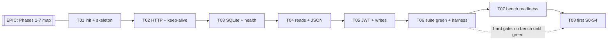

# Wayfinder Implementation Plan — Java Baseline, Phases 1–7

> Planning document only. No GitHub issues, milestones, branches, or application
> code were created from it. The next session consumes this file to publish the
> actual Wayfinder map, then stops before implementation.
> Truth hierarchy: `SPEC.md` + `test/test.sh` (42 checks) > `schema.sql` +
> `bench/load.js` + `bench/nginx.conf` > validated research findings >
> `reference/spring-boot-pr33` discussion > external technical sources.

## A. Executive summary

This blueprint designs the next Wayfinder map for
`LucaBert00/twelve-dollar-server-challenge`: the first complete, correct, and
reproducibly benchmarked independent Java implementation of the Twelve Dollar
Server Challenge, covering Phases 1–7 of the approved 13-phase roadmap in
`docs/IMPLEMENTATION_ROADMAP.md`.

The map consists of one Epic (`EPIC`), one milestone (`Task-3-Java-Baseline`),
and 8 implementation tickets (`T01`–`T08`). The tickets execute strictly
sequentially, directly on `main`, one verified increment per ticket per commit.
Phases 8–13 (optimization experiments DX-1–DX-8) are excluded from
implementation but the baseline is shaped so they can build on it without
rewrites.

Approved baseline carried from research: Java 25, JDK `HttpServer`, direct
JDBC via xerial `sqlite-jdbc`, HikariCP pool starting at 4, minimal
application shape, Nginx-first deployment, correctness before measurement.
`reference/spring-boot-pr33` (`7a9cb99`) stays a read-only correctness oracle;
nothing is merged or copied wholesale from it.

Four JDK HTTP configuration findings were verified against primary sources in
this session. One of them (`sun.net.httpserver.idleInterval`, default 30 s vs
the SPEC ≥ 65 s keep-alive rule) is a required baseline configuration and is
assigned to `T02`. The other three are dispositioned with explicit
do-not-touch or verify-only instructions.

## B. Verified repository context

Verified fresh this session (2026-10-14) via `git` and `gh`; nothing below is
assumed from the prompt.

- Current branch: `research/java-analysis`, HEAD `89969e2`
  (`docs(roadmap): implementation_roadmap closes #11`).
- `main` = `89969e2` (identical; `git rev-parse main` and `origin/main`
  both return `89969e2`). Working tree clean except pre-existing untracked
  `.idea/`.
- Remotes: `origin` = `https://github.com/LucaBert00/twelve-dollar-server-challenge.git`;
  `upstream` = `https://github.com/arjaythedev/twelve-dollar-server-challenge.git`.
  Never push to `upstream`.
- Protected references, both verified intact:
  - `backup/main-baseline-2026-10-13` = `026bdb6`.
  - `reference/spring-boot-pr33` = `7a9cb99` (read-only; inspected only via
    `git ls-tree` / `git show`, never checked out in the working tree).
- Previous research map (all on `LucaBert00`, milestone `Task-2-Research`):
  Epic #1 `[Wayfinder-0/11] TASK 2 Master Map` is OPEN (13 comments, full
  Decisions-so-far index). Issues #2–#12 are CLOSED, each with a claiming
  comment, a single-file commit, linear merge to `main`, and a closing
  comment recording SHAs and verification.
- Labels present include: `wayfinder`, `epic`, `wayfinder:map`,
  `wayfinder:task`, `wayfinder:research`, `research`, `analysis`,
  `architecture`, `benchmark`, `roadmap`, `blocked-needs-evidence`.
  No `implementation` label exists yet (next session creates it if wanted;
  this plan reuses existing labels only).
- Implementation status on `main`: no Java code exists.
  `submissions/` holds only `submissions/python-fastapi-cknutson12/` plus
  `README.md`. The reference branch holds
  `submissions/java-spring-boot-nb-99/` (35 files: `Application.java`,
  `Authentication.java`, `FeedController.java`, `PostRepository.java`,
  `Responses.java`, `ErrorHandler.java`, `ApiTest.java`,
  `application.properties`, `pom.xml`, `install.sh`/`build.sh`/`start.sh`,
  `OPTIMIZATIONS.md`, `benchmark.py`, deploy scripts) — oracle only.
- Key source files and their sizes: `SPEC.md` (84 lines), `schema.sql`
  (26 lines), `test/test.sh` (126 lines, gate `passed=42 failed=0` at
  lines 125–126), `test/run.sh` (31 lines, CI submission runner),
  `bench/load.js` (70 lines), `bench/nginx.conf` (30 lines, `keepalive 64`,
  gzip block lines 18–20), `seed/make-seed.sh` + `seed/generate.mjs`
  (deterministic 50k users / 500k posts / ~2M likes + 20k tokens),
  `test/golden/` (`feed.json`, `post-1.json`, `post-250000.json`,
  `post-500000.json`).
- Local toolchain (informational only; implementation builds on the
  benchmark box / CI per `test/run.sh`): Java 8 present, Maven absent.
  `T01` owns provisioning pins.
- Technical constraints carried forward: 1 vCPU / 2 GB RAM / no swap /
  Ubuntu 24.04; schema fixed; WAL + `synchronous=NORMAL`-or-stronger with
  commit-before-respond; no cross-request result caches; per-request JWT
  re-verification; `HOST`/`PORT`/`SQLITE_PATH`/`JWT_SECRET` env contract;
  build-from-source on the box; start ≤ 60 s; `LimitNOFILE=65535`.

## C. Research-to-implementation handoff

Decisions from completed research that materially constrain the new map.
Pointers only; nothing is re-derived here.

1. Architecture lane: Option A (Plain Java) is the build baseline;
   C-pin `7a9cb99` is the correctness oracle (shapes reusable with MIT
   notice, never merged); Option B (Netty) is profile-gated; Option D
   (minimal/FFM extreme) is headroom-gated late-stage only.
   Source: `research/findings/JAVA_ARCHITECTURE_DECISION.md` §§2–4.
2. Baseline posture (explicitly NOT optima): Hikari pool 4, Nginx-first,
   platform threads, reference SQL verbatim, `-Xmx512m` posture, no group
   commit, no GC tuning. Each has an owning experiment in Phases 8–12.
   Source: `docs/IMPLEMENTATION_ROADMAP.md` §§2/4.
3. ONE benchmark method for every run: correctness gate → S0–S4 limit-search
   → J11 per-level table (pass AND fail+1 rows) → EX-template; one variable
   per run; generator/conntrack falsifiers first.
   Source: `research/findings/BENCHMARK_STRATEGY.md` §§1–7.
4. SPEC-exact byte contract: compact JSON, exact key order, stored-text
   `created_at` passthrough, live `like_count`, full error table,
   auth-before-id ordering, trim-before-validate with code-point counting,
   201/200 like semantics. The suite (`test/test.sh`) wins any dispute.
   Source: `research/findings/FINAL_RESEARCH_REPORT.md` §§1–2 (V1–V6).
5. Prohibitions enforced per variant by code read: OPT-34 (caches/copies/
   remembered verifications), OPT-35 (weaker-than-NORMAL durability),
   OPT-36 (respond-before-commit), OPT-37 (schema changes), OPT-38 (kernel/
   pinning/box changes), OPT-39 (JWT downgrade).
   Source: `research/findings/OPTIMIZATION_CATALOG.md` §2.4.
6. Quarantined figures (never quoted as targets): OPT-40 (prior-video
   table), OPT-41 (`~0.77 ms` budget), OPT-42 (PR33 `~20%`/38k remarks),
   OPT-43 (PR58 laptop figures), OPT-44 (`~32k` port threshold).
7. Open questions Q1–Q9 from the final report stay open; none belong to
   Phases 1–7 except as noted: Q5/Q6 falsifier discipline is adopted into
   `T08`; Q1/Q2/Q3/Q4/Q7 are owned by Phases 10–12 and appear here only as
   handoff notes; Q8 (caption-slip figures) binds all tickets — no
   quarantined number appears in any proposed body; Q9 is closed by
   verbatim adoption of the ONE method.
8. Workflow conventions preserved from the research map: one coherent scope
   per ticket; one verified increment per completed ticket; explicit source
   references; objective acceptance criteria; recommended catalog skills;
   explicit stop conditions; no invented measurements; linear history; no
   upstream pushes; the forbidden-word filter (this document uses
   `minimal-diff senior-dev mode` phrasing throughout).
9. Change from the research workflow: `research/java-analysis` is retired.
   `main` is now the active development branch. Each ticket commits and
   pushes directly to `main` (see §M). The protected backup and reference
   branches remain untouched.

## D. Proposed Epic

Stable planning ID: `EPIC`. Suggested title:

`[Wayfinder-0/8] Java Baseline Implementation — Phases 1–7`

Labels: `epic`, `wayfinder`, `wayfinder:map`. Milestone: `Task-3-Java-Baseline`.

Complete ready-to-publish body:

```markdown
## Destination

A first complete, correct, and reproducibly benchmarked independent Java
implementation of the Twelve Dollar Server Challenge on `main`: all five
endpoints SPEC-exact, `test/test.sh` green (`passed=42 failed=0`) on a fresh
database, first k6 limit-search measured under the approved method with no
invented numbers. Phases 8–13 (optimization) are out of scope but must be
able to build on this baseline without rewrites.

## Notes

- Skills every session: `github`, `git-workflow`, `verification-before-completion`,
  plus the ticket-specific skills listed on each ticket. Invoke all of them via
  the skill tool; follow each skill exactly.
- Branch discipline: work directly on `main`. Begin from current `main`, verify
  a clean tree, execute only the ticket scope, run the ticket verification,
  commit to `main`, push `origin/main`, verify the pushed commit, close the
  issue only when acceptance criteria hold. Linear history; no feature branches;
  never push to `upstream`; never move `backup/main-baseline-2026-10-13` or
  `reference/spring-boot-pr33`.
- Forbidden-word filter is on: never write the forbidden term in any title, body,
  comment, or commit message (use `minimal-diff senior-dev mode` phrasing).
  Grep case-insensitively over the diff and the issue draft before every push.
- Truth hierarchy: SPEC.md + test/test.sh > schema.sql + bench/load.js +
  bench/nginx.conf > validated research findings > reference/spring-boot-pr33
  discussion > external sources.
- Architecture baseline (Option A, correctness-first): Java 25, JDK HttpServer,
  direct JDBC (xerial sqlite-jdbc), HikariCP pool starting at 4, minimal
  application shape, Nginx-first, `-Xmx512m` posture. Starting values are
  explicitly not optima; sizing belongs to Phases 8–13.
- `reference/spring-boot-pr33` (`7a9cb99`) is a read-only correctness oracle.
  Never merge it; never copy files wholesale. Verbatim shape reuse keeps the
  MIT notice.
- No invented measurements: the only performance reference is the `T08`
  measured baseline itself. Quarantined figures (prior-video tables, PR33/PR58
  remarks, laptop numbers, port-threshold constants) are never quoted as targets.
- Suggested skills for this task: `github, git-workflow, git-commit, writing-plans,
  documentation-writer, verification-before-completion`

## Scope

Phases 1–7 of `docs/IMPLEMENTATION_ROADMAP.md`: project init, HTTP baseline,
SQLite integration, complete API, JWT auth, official correctness, first
reproducible benchmark.

## Exclusions

- Phases 8–13 and all DX/EX optimization experiments (DX-1–DX-8).
- Netty / WebFlux / virtual-thread toggles / GC-matrix / group-commit /
  SQLite-JSON rewrites / direct-mode serving / native builds (all gated to
  future phases; see the handoff comment on this Epic).
- Upstream PRs, benchmark-batch submissions, score claims beyond the measured
  baseline with its spread.

## Inputs

- `SPEC.md`, `schema.sql`, `test/test.sh`, `test/run.sh`, `bench/load.js`,
  `bench/nginx.conf`, `README.md` (rules + scoring), `seed/make-seed.sh`.
- `docs/IMPLEMENTATION_ROADMAP.md` §§1–4 (ground truth, lanes, run book, phases).
- `research/findings/BENCHMARK_STRATEGY.md` §§1–7 (ONE method).
- `research/findings/JAVA_ARCHITECTURE_DECISION.md` §§2–4 (lanes + why-A).
- `research/findings/FINAL_RESEARCH_REPORT.md` §§1–2/10 (contract + prohibitions).

## Overall deliverables

- `submissions/java-jdk-lucabert00/` (name confirmed in T01): source,
  `install.sh` / `build.sh` / `start.sh`, `README.md`, `.gitignore`.
- JUnit gate harness mirroring the suite matrices.
- `test/test.sh` → `passed=42 failed=0` on a fresh database.
- First S0–S4 baseline table with pass AND fail+1 rows, profile artifacts,
  falsifier log entries. No score claimed beyond the measured rows.

## Dependency graph

Strictly sequential: T01 → T02 → T03 → T04 → T05 → T06 → T07 → T08.
No parallel execution (every ticket after T01 modifies the same submission
directory on `main`). Each ticket's `Blocked by` field names its predecessor.

## Completion criteria

- T01–T08 closed in order, each with its commit on `main` pushed to `origin`,
  its verification evidence pasted on the issue, and its acceptance criteria met.
- Gate D (`passed=42 failed=0`) and Gate F (first baseline table) recorded.
- No quarantined figure quoted; no prohibition violated; history linear;
  protected branches untouched.

## Correctness gates

- Gate A (build readiness): T01 — project builds reproducibly from source.
- Gate B (functional completeness): T04+T05 — all five endpoints serve the
  official contract.
- Gate C (authentication correctness): T05 — JWT shapes, error precedence,
  auth-before-id.
- Gate D (official correctness): T06 — `passed=42 failed=0` on fresh DB.
- Gate E (benchmark readiness): T07 — deploy config, startup, seed, limits,
  monitoring, scripts verified.
- Gate F (first baseline): T08 — S0–S4 run per the ONE method, table recorded.

## Future optimization handoff

On Epic close, post a handoff comment listing: the T08 baseline rows, profile
artifact paths, the deferred JDK settings (nodelay default-off, maxIdle
capped at 200, direct-mode unsized), open questions Q1–Q4/Q7 owned by Phases
10–12, and the escalation criteria (§L of the planning doc). Nothing in
Phases 1–7 pre-decides a lane change.

## Completion protocol

1. Forbidden-word filter: never write the forbidden term (any casing, spacing,
   or hyphenation) in the Epic title, body, or comments, or in any ticket or
   commit produced under it. Before every push, grep case-insensitively over
   the diff and the issue text; a hit blocks the push until rewritten.
2. Skills: every ticket executor MUST invoke that ticket's Suggested skills via
   the skill tool and follow each skill exactly.
3. `main` is the workspace from now on: every ticket commits directly to `main`
   and pushes to `origin/main` before its issue is closed (one ticket = one
   commit, linear history). This Epic closes last, after T08 and the future
   optimization handoff comment, with no code commit of its own.

## Wayfinder links

- Children: T01–T08 (to be created in order; wire `Blocked by` second pass).
```

## E. Proposed milestone

- Name: `Task-3-Java-Baseline`
- Description: `Java baseline implementation, Phases 1–7: first correct,
  suite-green, reproducibly benchmarked JDK server on main. Optimization
  (Phases 8–13) excluded.`
- Completion conditions (all required):
  1. `EPIC` and `T01`–`T08` all closed, in dependency order.
  2. Submission directory builds from source on a clean Ubuntu 24.04 image
     (`install.sh` + `build.sh` green) and starts within 60 s.
  3. `bash test/test.sh` prints `passed=42 failed=0` against a fresh database
     copy (Gate D evidence on `T06`).
  4. First S0–S4 baseline table with pass AND fail+1 rows recorded on `T08`
     (Gate F evidence), with no invented or extrapolated numbers.
  5. `git log --oneline --graph` from `backup/main-baseline-2026-10-13`
     through `main` is linear; protected branches untouched; no upstream push.

## F. Ticket decomposition rationale

Seven roadmap phases become eight tickets. The two splits are deliberate:

1. Phase 4 (API) + Phase 5 (JWT) become `T04` (unauthenticated reads:
   `GET /health` live, `GET /feed`, `GET /posts/:id`, JSON writer, error
   table) and `T05` (JWT verifier + `POST /posts` + `POST /posts/:id/like`
   with auth-first ordering). The JWT verifier (HS256-only, three 401
   shapes, `alg` rejection, `exp`/`sub`/`username` checks, constant-time
   compare) is a distinct deep module with its own test matrix; bundling it
   with the JSON writer and both write handlers would make one large,
   hard-to-review commit spanning three failure domains. The split follows
   the SPEC's own seam (unauthenticated vs authenticated routes) and each
   half has independent verification (golden byte-compare vs auth `curl`
   matrix).
2. Phase 7 becomes `T07` (benchmark readiness: startup flags, Nginx smoke,
   seed state, limits, monitoring, script hardening) and `T08` (first
   measured S0–S4 + J11 table). Readiness touches scripts and config;
   measurement produces evidence logs. A red readiness check must block
   measurement without contaminating it, and each commit stays coherent.

Everything else maps 1:1 (T01→P1, T02→P2, T03→P3, T06→P6). No micro-tickets:
every ticket ends in a runnable server state with its own falsifiable
verification, and every ticket is sized for one agent session and one commit.

## G. Complete ticket specifications

Conventions applying to every ticket below: labels `wayfinder`,
`wayfinder:task` (+ `benchmark` on `T08`); milestone
`Task-3-Java-Baseline`; title form `[Wayfinder-N/8]`; planning IDs `T01`–`T08`
until the next session replaces them with real issue numbers and links; each
ticket names its parent Epic, its predecessor (`Blocked by`), and its
successor; each ticket repeats the 8-step direct-to-main Git workflow
verbatim so executors never need to look it up.

---

### T01 — `[Wayfinder-1/8] Project init, pins, submission skeleton`

```markdown
## Objective

Create `submissions/java-jdk-lucabert00/` (confirm this exact name; it must match
`submissions/<language>-<framework>-<github-username>/`) with pinned toolchain,
minimal dependencies, lifecycle scripts, and a skeleton server that builds and
starts but serves no API yet.

## Context

First implementation increment (Roadmap Phase 1). Every later ticket builds on
this skeleton's pins and scripts. Decisions here (build tool, dependency set,
package layout) are cheap to change now and expensive later.

## Inputs to read

- `README.md` §§Rules/Submitting (scripts contract, source-only, 60 s start).
- `test/run.sh` (what CI executes: build → start on fresh DB copy → suite).
- `docs/IMPLEMENTATION_ROADMAP.md` §4 Phase 1.
- `research/findings/JAVA_ARCHITECTURE_DECISION.md` §2.1 (Option A shape).
- `research/findings/FINAL_RESEARCH_REPORT.md` §11 (license posture:
  Apache-2.0 deps manifest-noted; MIT upstream).
- Reference only (never copy wholesale):
  `reference/spring-boot-pr33:submissions/java-spring-boot-nb-99/pom.xml`,
  `install.sh`, `build.sh`, `start.sh` (Maven + script shape precedent).

## Tasks checklist

- [ ] Confirm submission dir name `submissions/java-jdk-lucabert00/` (owner:
      LucaBert00). If the owner renames it, update EPIC + all tickets first.
- [ ] Pin JDK 25 distribution with version string + checksum recorded in the
      submission README (Temurin or Oracle; verify availability for Ubuntu
      24.04 x86_64 at pin time; Java 21+ is the floor, 25 is the approved line).
- [ ] Choose Maven (default; matches the reference build) or Gradle with one
      stated reason. Pin the exact version.
- [ ] Pin `org.xerial:sqlite-jdbc` exact version + checksum. Add HikariCP only
      (pool-4 start per OPT-07). JSON library decision is owned by T04 — do NOT
      add Jackson here unless T04 is merged into this ticket by owner approval
      (default: decide in T04; keep this set minimal).
- [ ] Write `install.sh` (root, clean Ubuntu 24.04: toolchain install),
      `build.sh` (normal user: offline-capable pinned build, no prebuilt
      binaries), `start.sh` (foreground exec, honors `SQLITE_PATH` /
      `JWT_SECRET` / `HOST` / `PORT`, JVM flags placeholder for T02/T07).
- [ ] Skeleton `main` class (package `challenge`): binds `HOST:PORT`, answers
      every path with 404 `{"error":"not found"}` compact JSON, exits 0 on SIGTERM.
- [ ] Submission `README.md`: language/driver/versions, Nginx-or-direct choice
      (Nginx-first), placeholder optimizations section (empty until measured),
      license notices for direct dependencies.
- [ ] `.gitignore`: `target/`, `*.class`, DB copies (`*.db*`), JFR dumps, logs.
      Never commit `feed.db` or artifacts.

## Expected outputs

- `submissions/java-jdk-lucabert00/` with `pom.xml` (or Gradle equivalent),
  `install.sh`, `build.sh`, `start.sh`, `README.md`, `.gitignore`,
  `src/main/java/challenge/` skeleton.
- No endpoint logic, no database code, no JWT code.

## Acceptance criteria

- [ ] `./build.sh` green from a clean checkout (pinned deps only).
- [ ] `./start.sh` serves within 60 s; `GET /nope` → 404 `{"error":"not found"}`
      byte-exact with `Content-Type: application/json`.
- [ ] `git status` shows no build artifacts, DB copies, or logs.
- [ ] Pins (JDK + driver + build tool) re-printable via one command and recorded
      in the submission README with checksums.

## Verification

```bash
git status --short --branch   # clean except this ticket's files
bash submissions/java-jdk-lucabert00/build.sh
SQLITE_PATH=/tmp/empty.db JWT_SECRET=twelve-dollar-challenge HOST=127.0.0.1 PORT=3000 \
  bash submissions/java-jdk-lucabert00/start.sh &
curl -s -i http://127.0.0.1:3000/nope | head -20   # expect 404 exact bytes
```

## Dependencies

- Blocked by: none (first).
- Blocks: T02.

## Explicit exclusions

No routing beyond the 404 fallback, no SQLite, no JSON writer, no JWT, no
benchmarking, no GC/threading/pool tuning, no Jackson decision (T04 owns it).

## Risks and stop conditions

- Pinned JDK unavailable for Ubuntu 24.04 x86_64 → STOP, report alternatives
  to the owner; do not silently take a different major version.
- Build-from-source fails on a clean image → fix pins/scripts; nothing advances
  until green (Gate A).
- Transitive dependency drift → lockfile + checksums; record rejections.

## Suggested skills for this task

`github, git-workflow, git-commit, writing-plans, documentation-writer, verification-before-completion`

Executor MUST invoke the above skills via the skill tool.

## Standing rules (mandatory for this ticket)

1. Forbidden-word filter: never write the forbidden term (any casing, spacing,
   or hyphenation) in the issue title, body, comments, or commit message. If
   that concept is needed, write `minimal-diff senior-dev mode`. Before every
   push, grep case-insensitively over the diff and the issue text; a hit blocks
   the push until rewritten.
2. Skills: invoke every skill listed under Suggested skills above via the skill
   tool and follow each skill exactly. Do not claim a skill was used unless it
   was actually invoked.
3. Completion protocol (`main` is the workspace from now on): when the work is
   done and the Verification block passes, commit directly to `main` (exactly
   one commit for this ticket), push to `origin/main`, verify the pushed
   commit, then close this issue with a comment recording the commit SHA, the
   files changed, and the verification output. Never batch multiple tickets
   into one commit; never close an issue without its commit pushed to
   `origin/main`.

## Git workflow (direct-to-main, all tickets)

1. `git checkout main && git pull origin main` (start from current `main`).
2. `git status` — tree must be clean before work.
3. Execute only this ticket's scope.
4. Run this ticket's Verification block.
5. Commit directly to `main` (message form:
   `feat(java-baseline): <short title> closes #<N>` with the real issue number).
6. `git push origin main`.
7. Verify the pushed commit (`git log origin/main -1`, `git status` clean).
8. Close the issue only after acceptance criteria hold, with a comment recording
   the commit SHA, files, and verification output.

## Wayfinder links

- Parent Epic: EPIC. Blocked by: none. Blocks: T02 (HTTP baseline).
```

### T02 — `[Wayfinder-2/8] HTTP server baseline, router, keep-alive`

```markdown
## Objective

Blocking-handler JDK `HttpServer` behind Nginx (`127.0.0.1:3000`) with a
5-path router returning SPEC-shaped stubs, idle/keep-alive sized for the Nginx
64-idle envelope, and request-logging hooks for later benchmark columns.

## Context

Roadmap Phase 2. This ticket also lands the one REQUIRED JDK finding from the
planning session: `sun.net.httpserver.idleInterval` defaults to 30 s (JDK
module docs) while SPEC requires idle ≥ 65 s behind Nginx — so the default
must be overridden in `start.sh`. No other JDK knob changes in this ticket.

## Inputs to read

- `SPEC.md` §§Runtime contract/Responses (keep-alive, ≥65 s rule, compact JSON).
- `bench/nginx.conf` (`keepalive 64`).
- `docs/IMPLEMENTATION_ROADMAP.md` §4 Phase 2.
- `research/findings/JAVA_ARCHITECTURE_DECISION.md` §2.1 (HTTP cut).
- Planning doc §K (verified JDK findings: idleInterval REQUIRED=70;
  maxIdleConnections=200 recorded, unchanged; nodelay=false unchanged).

## Tasks checklist

- [ ] Server bootstrap: `com.sun.net.httpserver.HttpServer`, bound to
      `HOST:PORT` from env, fixed thread pool sized and recorded (starting
      posture; tuning belongs to Phases 9–11 — do not tune here).
- [ ] Router for the 5 paths + 404 `{"error":"not found"}` fallback with exact
      bytes and `Content-Type: application/json`. Handlers return stubs only
      (real logic in T03–T05); `GET /health` stub responds (DB check in T03).
- [ ] `start.sh`: add `-Dsun.net.httpserver.idleInterval=70` (seconds; satisfies
      the ≥65 s rule with the same value class as the reference 70 s pin) and
      echo all `sun.net.httpserver.*` flags to the startup log. Record
      `maxIdleConnections` default (200, covers the 64-idle envelope, unchanged)
      and `nodelay=false` (unchanged, experimental — deferred to Phase 10) in a
      code comment + submission README note.
- [ ] Request logging hooks: accept-queue depth, refused connections, response
      codes — the fields §3.4 needs later. No profiling agent yet.
- [ ] `LimitNOFILE`/backlog sizing notes for later direct mode (notes only;
      no direct serving — DX-3 owns it in Phase 10).

## Expected outputs

- Router + handlers skeleton in `src/main/java/challenge/`; updated `start.sh`
  with the idle flag; README note documenting the three JDK settings and why
  only one changed.

## Acceptance criteria

- [ ] Unknown path → 404 exact bytes; the 5 stub paths respond (any stub body).
- [ ] Startup log shows `sun.net.httpserver.idleInterval=70` in effect.
- [ ] An idle keep-alive connection through the Nginx config (or a local
      equivalent holding 64 idle conns) survives ≥65 s without RSS blowup.
- [ ] No framework, no JSON library, no database code added.

## Verification

```bash
curl -s -D - http://127.0.0.1:3000/nope -o /tmp/b && cat /tmp/b  # exact 404 bytes
# idle-hold: open connection, sleep 70, reuse — must still be alive (log excerpt pasted on issue)
```

## Dependencies

- Blocked by: T01. Blocks: T03.

## Explicit exclusions

No database, no JSON serialization beyond stub strings, no JWT, no direct-mode
(`0.0.0.0:80`) serving, no `maxIdleConnections`/`nodelay` changes, no thread/
pool/GC tuning, no stdlib-replacing HTTP code (no hand parser — that shape is
gated to Phase 12/DX-8 and stays out of this baseline).

## Risks and stop conditions

- JDK server cannot hold 64 idle conns ≥65 s within bounded RSS → record the
  numbers, STOP, escalate to the owner; envelope questions feed Phase 10, not
  this ticket. Do not pre-decide Netty/direct here.
- Over-engineering the router (framework-shaped abstractions) → strip back to
  stdlib + minimal-diff senior-dev mode.

## Suggested skills for this task

`systematic-debugging, codebase-design, java-docs, github, git-workflow, git-commit, verification-before-completion`

Executor MUST invoke the above skills via the skill tool.

## Standing rules (mandatory for this ticket)

1. Forbidden-word filter: never write the forbidden term (any casing, spacing,
   or hyphenation) in the issue title, body, comments, or commit message. If
   that concept is needed, write `minimal-diff senior-dev mode`. Before every
   push, grep case-insensitively over the diff and the issue text; a hit blocks
   the push until rewritten.
2. Skills: invoke every skill listed under Suggested skills above via the skill
   tool and follow each skill exactly. Do not claim a skill was used unless it
   was actually invoked.
3. Completion protocol (`main` is the workspace from now on): when the work is
   done and the Verification block passes, commit directly to `main` (exactly
   one commit for this ticket), push to `origin/main`, verify the pushed
   commit, then close this issue with a comment recording the commit SHA, the
   files changed, and the verification output. Never batch multiple tickets
   into one commit; never close an issue without its commit pushed to
   `origin/main`.

## Git workflow

Per the 8-step direct-to-main workflow on T01 (same steps, this ticket's scope
and verification).

## Wayfinder links

- Parent Epic: EPIC. Blocked by: T01. Blocks: T03 (SQLite).
```

### T03 — `[Wayfinder-3/8] SQLite integration, pragmas, live health`

```markdown
## Objective

Durable SQLite layer: WAL + `synchronous=NORMAL` + foreign-keys-on +
`busy_timeout=5000` enforced on EVERY pooled connection with startup
assertions, HikariCP pool of 4 (explicit start value, not optimum),
prepare-once-per-connection posture, SPEC reference SQL, and a live-DB
`GET /health`.

## Context

Roadmap Phase 3. Durability and pragma discipline from here on is load-bearing:
every later ticket assumes per-connection pragmas hold. Reference SQL is the
immutable fallback for all later SQL experiments (Phases 8+).

## Inputs to read

- `schema.sql` (fixed schema + 3 indexes; no changes permitted).
- `SPEC.md` §§Responses/Auth + README.md rules 5–6 (no caches; WAL+NORMAL floor,
  commit-before-respond).
- `docs/IMPLEMENTATION_ROADMAP.md` §4 Phase 3.
- Oracle shapes only (never merge):
  `reference/spring-boot-pr33:submissions/java-spring-boot-nb-99/src/main/java/challenge/Application.java`
  (pool/pragma block) and `PostRepository.java` (reference SQL).

## Tasks checklist

- [ ] Pool wiring (HikariCP, 4 connections) + per-connection pragma block
      (`journal_mode=WAL`, `synchronous=NORMAL`, `foreign_keys=ON`,
      `busy_timeout=5000`) applied on every connection acquisition, with a
      startup assertion query on all 4 conns that fails fast if any pragma
      did not hold (session-only reversion guard).
- [ ] Prepared-statement lifecycle: prepare at startup (or first checkout),
      reset + rebind per use (OPT-06 posture; plan reuse, never result caching).
- [ ] SPEC reference SQL verbatim for the three read shapes (feed
      correlated-count with `ORDER BY created_at DESC, id DESC LIMIT 20`;
      single-post lookup; like upsert) plus `INSERT ... RETURNING` for posts.
- [ ] `GET /health`: `SELECT 1` → 200
      `{"status":"ok","db":"ok","uptime_s":<int>}`; on failure 503
      `{"status":"degraded","db":"unreachable","error":<string>}`.
- [ ] `EXPLAIN QUERY PLAN` capture on a fresh database, archived under
      `submissions/java-jdk-lucabert00/docs/` (baseline artifact for DX-1).

## Expected outputs

- Data-access classes (one clear owner for pool/pragmas/SQL), live health
  handler, plan artifact. No feed/post/like handler logic yet (T04/T05).

## Acceptance criteria

- [ ] Pragma assertions pass on all 4 connections at startup (log pasted).
- [ ] `GET /health` returns live-DB 200 with the exact shape; killing the DB
      path yields the 503 shape (or documented equivalent failure drill).
- [ ] Plan artifact stored; `cache_size`-class session-only drift noted as a
      per-variant re-assertion rule.
- [ ] Code-read check: no result caching, no table copies, schema diff empty.

## Verification

```bash
# startup log: 4/4 pragma assertions + pool size
curl -s http://127.0.0.1:3000/health   # exact 200 shape
sqlite3 /tmp/verify.db "PRAGMA journal_mode; PRAGMA synchronous;"  # WAL + NORMAL(1)
```

## Dependencies

- Blocked by: T02. Blocks: T04.

## Explicit exclusions

No endpoint handlers beyond health, no JSON library decision (T04), no JWT
(T05), no pool-size sweep or writer-queue (DX-2/Phase 8), no FULL-vs-NORMAL
change (single probe gated to Phase 11), no `cache_size`/`mmap`/checkpoint
knobs (Phase 11 tails).

## Risks and stop conditions

- Pragmas revert per-session (pool resets them) → fix wiring to set per
  checkout; NEVER proceed on assumed pragmas. This is a hard stop.
- Pool-4 assumed optimal by a later reader → keep the `starting point, not
  optimum` comment in code and README.

## Suggested skills for this task

`systematic-debugging, codebase-design, java-docs, github, git-workflow, git-commit, verification-before-completion`

Executor MUST invoke the above skills via the skill tool.

## Standing rules (mandatory for this ticket)

1. Forbidden-word filter: never write the forbidden term (any casing, spacing,
   or hyphenation) in the issue title, body, comments, or commit message. If
   that concept is needed, write `minimal-diff senior-dev mode`. Before every
   push, grep case-insensitively over the diff and the issue text; a hit blocks
   the push until rewritten.
2. Skills: invoke every skill listed under Suggested skills above via the skill
   tool and follow each skill exactly. Do not claim a skill was used unless it
   was actually invoked.
3. Completion protocol (`main` is the workspace from now on): when the work is
   done and the Verification block passes, commit directly to `main` (exactly
   one commit for this ticket), push to `origin/main`, verify the pushed
   commit, then close this issue with a comment recording the commit SHA, the
   files changed, and the verification output. Never batch multiple tickets
   into one commit; never close an issue without its commit pushed to
   `origin/main`.

## Git workflow

Per the 8-step direct-to-main workflow on T01.

## Wayfinder links

- Parent Epic: EPIC. Blocked by: T02. Blocks: T04 (unauthenticated API).
```

### T04 — `[Wayfinder-4/8] Unauthenticated API: feed, single post, JSON exactness`

```markdown
## Objective

All unauthenticated behavior byte-exact: `GET /feed` (20 newest), `GET
/posts/:id`, the compact-JSON writer with exact key order, and the full error
table for these routes (`not found`, `invalid post id`, `post not found`).

## Context

Roadmap Phase 4 (reads half). Owns the JSON serialization decision for the
whole submission: hand-rolled minimal writer vs Jackson singleton. Default
recommendation is Jackson (correctness-first: `"`/`\`/unicode-escape and
surrogate-pair handling is a SPEC liability; Apache-2.0, manifest-noted).
Either choice must pass the golden byte gate; the decision and its reason are
recorded in the submission README.

## Inputs to read

- `SPEC.md` §§Responses/Endpoints/Errors (post object, key order, feed order,
  id validation, 404 shapes).
- `test/test.sh` §§golden reads + id validation (lines 51–66) and
  `test/golden/*.json` (byte targets; second run on the same DB fails by design).
- `docs/IMPLEMENTATION_ROADMAP.md` §4 Phase 4.
- Oracle shapes only: reference `Responses.java`/`ErrorHandler.java`
  (key-order discipline, error shapes).

## Tasks checklist

- [ ] JSON writer with key-order discipline (`id,body,created_at,author,
      like_count`; feed wrapper `posts`; single wrapper `post`), compact form,
      `created_at` sent as stored, live `like_count` per request, UTF-8
      round-trip (`<>&/` escaping optional; café/emoji must round-trip per the
      suite's special-characters check).
- [ ] `GET /feed`: 20 newest, `ORDER BY created_at DESC, id DESC`, exact bytes
      vs `test/golden/feed.json` on a fresh DB.
- [ ] `GET /posts/:id`: id matrix `0,-1,abc,1.5` → 400 `invalid post id`;
      missing → 404 `post not found`; exact bytes vs golden post files.
- [ ] Unknown paths and wrong-method behavior unchanged from T02 (SPEC
      out-of-scope rows: do whatever the framework does; record the choice).
- [ ] Trim/500-code-point and like logic are T05 — do not implement here.

## Expected outputs

- Feed + single-post handlers, JSON module (+ Jackson pin only if chosen),
  README note recording the serialization decision and why.

## Acceptance criteria

- [ ] On a FRESH database copy: `GET /feed` and `GET /posts/1|250000|500000`
      match `test/golden/*.json` byte-for-byte; `Content-Type` is
      `application/json`.
- [ ] Full id-validation matrix green via `curl` (documented commands + outputs
      on the issue).
- [ ] `like_count` reflects the database as of the request (prove with a
      like-then-read drill at the SQL level if handlers are absent — or defer
      the read-back proof to T06 with an explicit note).

## Verification

```bash
rm -f /tmp/t04.db && cp seed/feed.db /tmp/t04.db
SQLITE_PATH=/tmp/t04.db ... ./start.sh &
curl -s http://127.0.0.1:3000/feed | cmp - test/golden/feed.json && echo FEED-BYTES-OK
for id in 1 250000 500000; do curl -s http://127.0.0.1:3000/posts/$id | cmp - test/golden/post-$id.json && echo POST-$id-OK; done
```

## Dependencies

- Blocked by: T03. Blocks: T05.

## Explicit exclusions

No JWT, no `POST` handlers, no JUnit harness (T06 owns it), no SQLite-JSON
rewrites or query-shape changes (DX-1/Phase 8), no serialization tuning beyond
correctness (OPT-23 gated to Phase 11).

## Risks and stop conditions

- Golden mismatch on escaping/key order/`created_at` format → fix the writer;
  goldens are the arbiter, never the code. No bench until bytes match.
- UTF-16 vs code-point length confusion → note it here; the 501-char proof
  lands in T05/T06.

## Suggested skills for this task

`test-driven-development, java-junit, java-docs, codebase-design, github, git-workflow, git-commit, verification-before-completion`

Executor MUST invoke the above skills via the skill tool.

## Standing rules (mandatory for this ticket)

1. Forbidden-word filter: never write the forbidden term (any casing, spacing,
   or hyphenation) in the issue title, body, comments, or commit message. If
   that concept is needed, write `minimal-diff senior-dev mode`. Before every
   push, grep case-insensitively over the diff and the issue text; a hit blocks
   the push until rewritten.
2. Skills: invoke every skill listed under Suggested skills above via the skill
   tool and follow each skill exactly. Do not claim a skill was used unless it
   was actually invoked.
3. Completion protocol (`main` is the workspace from now on): when the work is
   done and the Verification block passes, commit directly to `main` (exactly
   one commit for this ticket), push to `origin/main`, verify the pushed
   commit, then close this issue with a comment recording the commit SHA, the
   files changed, and the verification output. Never batch multiple tickets
   into one commit; never close an issue without its commit pushed to
   `origin/main`.

## Git workflow

Per the 8-step direct-to-main workflow on T01.

## Wayfinder links

- Parent Epic: EPIC. Blocked by: T03. Blocks: T05 (JWT + writes).
```

### T05 — `[Wayfinder-5/8] JWT auth plus post creation and likes`

```markdown
## Objective

HS256 per-request JWT verification with the three exact 401 shapes and
auth-first routing, plus `POST /posts` (trim/validate/201) and
`POST /posts/:id/like` (201-first/200-repeat/404/400) — completing all five
endpoints (Gates B and C).

## Context

Roadmap Phases 4 (writes half) + 5. The JWT verifier is a small, deep module:
HMAC-SHA256, constant-time compare, `alg` rejection (including `none`),
`exp` enforcement, `sub` positive-integer-string + `username` string checks.
Auth runs before id validation on `POST /posts/:id/like` (401 without token,
400 with valid token on `abc`).

## Inputs to read

- `SPEC.md` §§Endpoints/Errors/Auth (auth-first rule, three 401 messages,
  create validation, like semantics).
- `test/test.sh` §§auth + create validation + create/like/read-back
  (lines 68–123).
- `docs/IMPLEMENTATION_ROADMAP.md` §§4 Phases 4–5.
- Oracle shapes only: reference `Authentication.java` + FeedController order.

## Tasks checklist

- [ ] JWT verifier module: stdlib `javax.crypto.Mac` (HMAC-SHA256) +
      `java.util.Base64` URL decoder; `ThreadLocal` reuse only in the
      documented-safe shape with `remove()` (or per-request init — simplest
      correct shape wins; no pooling cleverness).
- [ ] Exact 401 shapes: `missing bearer token` (absent/non-`Bearer `),
      `invalid or expired token` (bad signature/`none`/wrong alg/expired/
      malformed), `invalid token payload` (bad `sub`/`username`).
- [ ] Router ordering: auth-first on both authed routes (prove
      `POST /posts/abc/like` → 401 without token, 400 with valid token).
- [ ] `POST /posts`: trim-before-validate; 500 code points after trim (code
      points, not UTF-16); `malformed JSON body` / `body is required` /
      `body must be at most 500 characters`; 201 with trimmed body,
      `like_count:0`, author = token username, `created_at` = DB default.
- [ ] `POST /posts/:id/like`: existence check (SQLite FKs are off by default —
      the app checks); first 201 `already_liked:false`, repeat 200 `true`;
      missing post 404; `abc` 400 (after auth).
- [ ] Writes commit before responding (single-statement transactions; group
      commit explicitly NOT here — DX-6/Phase 8 decides).

## Expected outputs

- Auth module + two write handlers + router ordering; README note on the
  per-request HMAC cost (compliance price, never cached — OPT-39 prohibited).

## Acceptance criteria

- [ ] `curl` matrix green: all auth rows (no-token/Basic/garbage/bad-sig/
      `none`/expired/bad-sub/no-name/auth-before-id), all create-validation
      rows (empty/whitespace/numeric/missing/malformed/501-char), like
      201→200→404→400 rows, read-back `like_count:1`, feed top-of-feed.
- [ ] No remembered verifications (code-read: verify runs per request).

## Verification

```bash
# fresh DB; targeted curl matrix mirroring test/test.sh:68-123 (paste commands + outputs on the issue)
# full-suite run belongs to T06 — here the matrix is the gate
```

## Dependencies

- Blocked by: T04. Blocks: T06.

## Explicit exclusions

No JUnit harness (T06), no login endpoint (none exists per SPEC), no JWT
caching/downgrade (OPT-34/OPT-39 prohibited — permanent), no group commit or
atomic-like rewrite (DX-6/Phase 8), no `ThreadLocal` sharing beyond the
documented shape.

## Risks and stop conditions

- Any 401-shape mismatch → fix verifier/router; no advance until the matrix
  is green (Gate C).
- JWT library temptation (adding a dep for parsing) → allowed only if smaller
  than the stdlib shape; record the reason either way.

## Suggested skills for this task

`test-driven-development, java-junit, java-docs, systematic-debugging, github, git-workflow, git-commit, verification-before-completion`

Executor MUST invoke the above skills via the skill tool.

## Standing rules (mandatory for this ticket)

1. Forbidden-word filter: never write the forbidden term (any casing, spacing,
   or hyphenation) in the issue title, body, comments, or commit message. If
   that concept is needed, write `minimal-diff senior-dev mode`. Before every
   push, grep case-insensitively over the diff and the issue text; a hit blocks
   the push until rewritten.
2. Skills: invoke every skill listed under Suggested skills above via the skill
   tool and follow each skill exactly. Do not claim a skill was used unless it
   was actually invoked.
3. Completion protocol (`main` is the workspace from now on): when the work is
   done and the Verification block passes, commit directly to `main` (exactly
   one commit for this ticket), push to `origin/main`, verify the pushed
   commit, then close this issue with a comment recording the commit SHA, the
   files changed, and the verification output. Never batch multiple tickets
   into one commit; never close an issue without its commit pushed to
   `origin/main`.

## Git workflow

Per the 8-step direct-to-main workflow on T01.

## Wayfinder links

- Parent Epic: EPIC. Blocked by: T04. Blocks: T06 (official correctness).
```

### T06 — `[Wayfinder-6/8] Official correctness: suite green, harness, oracle diff`

```markdown
## Objective

Gate D: `bash test/test.sh` → `passed=42 failed=0` on a fresh database for the
exact committed build, plus a JUnit gate harness, a signed rule 5/6 code-read
checklist, and an oracle spot-diff against C-pin `7a9cb99`. This ticket is the
standing pre-bench permission — nothing benchmarks until it is green.

## Context

Roadmap Phase 6. Converts the T04/T05 handler-level proofs into the official
verdict and leaves behind the repeatable harness (JUnit + fresh-DB gate
discipline) that every later variant re-runs.

## Inputs to read

- `test/test.sh` (all 126 lines — the gate), `test/run.sh` (CI discipline).
- `docs/IMPLEMENTATION_ROADMAP.md` §4 Phase 6.
- `research/findings/BENCHMARK_STRATEGY.md` §1 (copy-paste gate block).
- Oracle: C-pin `7a9cb99` response shapes (spot-diff sample responses;
  reuse with MIT notice where applicable).

## Tasks checklist

- [ ] Fresh-DB gate discipline scripted (rebuild → copy → start → gate →
      record → kill, per the §3.1 run book): `bash seed/make-seed.sh` (only if
      a rebuild is needed), `cp seed/feed.db /tmp/…`, gate, record suite SHA +
      DB md5 + `passed=42 failed=0` line.
- [ ] JUnit harness: `*Test` classes, AAA, `@ParameterizedTest`
      (`@ValueSource`/`@CsvSource`) for the id + auth matrices,
      `@Tag("gate")` vs `@Tag("bench")` separation; `mvn test` / `gradle test`
      runs the gate tags green.
- [ ] Rule 5/6 code-read checklist v1, signed in the build log: no
      response/query caches, no table copies, no remembered verifications;
      WAL + NORMAL-or-stronger on every conn; commit-before-respond; schema
      diff empty; JWT strict (HS256-only, `exp`+payload enforced).
- [ ] Oracle spot-diff: byte-compare sample responses (feed, single post,
      error shapes) against C-pin behavior; log agreements and any deliberate
      allowed-strict extras with suite-consistent justification.
- [ ] Prove freshness discipline: second run on the SAME database fails golden
      checks by design (expected — paste the failure as proof the gate is real).

## Expected outputs

- JUnit suite under `src/test/java/`; gate script/notes; checklist + oracle
  diff recorded on the issue (and archived under the submission folder docs).

## Acceptance criteria

- [ ] `bash test/test.sh http://127.0.0.1:3000` → `passed=42 failed=0` on a
      fresh DB, pasted verbatim with suite SHA + DB md5.
- [ ] JUnit gate tags green; checklist signed; oracle spot-diff logged.
- [ ] `bash test/run.sh submissions/java-jdk-lucabert00` passes end-to-end
      (what CI runs).

## Verification

```bash
bash test/run.sh submissions/java-jdk-lucabert00   # IS the verification
# plus: JUnit report path + checklist + oracle diff pasted on the issue
```

## Dependencies

- Blocked by: T05. Blocks: T07.
- Hard gate: any red → no bench, ever. T07/T08 do not start until green.

## Explicit exclusions

No benchmarking, no tuning of any kind, no lane/stack changes, no
quoting of any performance number as a result (no measurements exist yet).

## Risks and stop conditions

- Stale-DB false green/red → md5-recorded fresh copy per gate attempt.
- Oracle-drift confusion (live head vs pin) → cite pin `7a9cb99` only.
- Suite-vs-SPEC disagreement → the suite wins per SPEC; record the conflict
  as a newly discovered contradiction for the owner.

## Suggested skills for this task

`test-driven-development, java-junit, code-review, github, git-workflow, git-commit, verification-before-completion`

Executor MUST invoke the above skills via the skill tool.

## Standing rules (mandatory for this ticket)

1. Forbidden-word filter: never write the forbidden term (any casing, spacing,
   or hyphenation) in the issue title, body, comments, or commit message. If
   that concept is needed, write `minimal-diff senior-dev mode`. Before every
   push, grep case-insensitively over the diff and the issue text; a hit blocks
   the push until rewritten.
2. Skills: invoke every skill listed under Suggested skills above via the skill
   tool and follow each skill exactly. Do not claim a skill was used unless it
   was actually invoked.
3. Completion protocol (`main` is the workspace from now on): when the work is
   done and the Verification block passes, commit directly to `main` (exactly
   one commit for this ticket), push to `origin/main`, verify the pushed
   commit, then close this issue with a comment recording the commit SHA, the
   files changed, and the verification output. Never batch multiple tickets
   into one commit; never close an issue without its commit pushed to
   `origin/main`.

## Git workflow

Per the 8-step direct-to-main workflow on T01.

## Wayfinder links

- Parent Epic: EPIC. Blocked by: T05. Blocks: T07 (benchmark readiness).
```

### T07 — `[Wayfinder-7/8] Benchmark readiness: deploy, startup, seed, limits`

```markdown
## Objective

Gate E: everything the first benchmark assumes, verified before it runs —
final `start.sh` flags, Nginx smoke, seed state, resource limits, monitoring
columns, and script hardening. No load numbers are produced here.

## Context

First half of Roadmap Phase 7. Separates readiness (config) from measurement
(evidence) so a red readiness check blocks T08 without contaminating it.

## Inputs to read

- `docs/IMPLEMENTATION_ROADMAP.md` §§3–4 (run book + Phase 7 tasks).
- `research/findings/BENCHMARK_STRATEGY.md` §§2/4 (harness + monitoring columns).
- `SPEC.md` §§Runtime contract (env vars, Nginx vs direct) + `bench/nginx.conf`.

## Tasks checklist

- [ ] `start.sh` final: `-Dsun.net.httpserver.idleInterval=70` retained and
      echoed; JVM posture `-Xmx512m` default collector (explicitly the standing
      posture, not a tuned value — DX-7 owns tuning); foreground exec; env-only
      configuration; ≤60 s healthy start.
- [ ] Nginx smoke: app behind `bench/nginx.conf` equivalent serves the suite's
      health + feed correctly; 65 s idle rule holds through Nginx.
- [ ] Seed state: `bash seed/make-seed.sh` reproducibility confirmed
      (content-sha OK line); fresh-copy-per-run discipline documented.
- [ ] Resource/limit notes: `LimitNOFILE` accounting, backlog value, heap-vs-RSS
      accounting inside 2 GB with Nginx resident; JFR cap + rotate plan for T08.
- [ ] Monitoring columns ready per §3.4 (k6 stats, srv CPU%, srv RSS/free, gen
      CPU/RAM, mode, gate line, verdict) — template only, no numbers.
- [ ] k6-on-separate-machine requirement + drain-wait discipline recorded as
      T08 preconditions.

## Expected outputs

- Hardened `start.sh` (+ `install.sh`/`build.sh` touch-ups if the clean-image
  rehearsal finds gaps); README deploy section (Nginx-first declared);
  readiness checklist on the issue.

## Acceptance criteria

- [ ] Clean-image rehearsal: `install.sh` + `test/run.sh` green from scratch.
- [ ] Gate line still `passed=42 failed=0` after all script changes (re-gate).
- [ ] Readiness checklist complete: flags echoed, Nginx smoke green, seed OK,
      limits recorded, monitoring template ready.

## Verification

```bash
bash test/run.sh submissions/java-jdk-lucabert00   # re-gate after script changes
curl -s http://127.0.0.1:3000/health               # through Nginx where configured
# startup log excerpt (flags) + seed OK line pasted on the issue
```

## Dependencies

- Blocked by: T06 (bench permission). Blocks: T08.

## Explicit exclusions

No k6 runs, no S0–S4, no performance numbers, no tuning (flags are posture,
not optima), no direct-mode serving (Phase 10).

## Risks and stop conditions

- Clean-image build fails → fix scripts; T08 does not start.
- Any script change reddens the suite → revert to last green scripts, re-gate.

## Suggested skills for this task

`systematic-debugging, documentation-writer, github, git-workflow, git-commit, verification-before-completion`

Executor MUST invoke the above skills via the skill tool.

## Standing rules (mandatory for this ticket)

1. Forbidden-word filter: never write the forbidden term (any casing, spacing,
   or hyphenation) in the issue title, body, comments, or commit message. If
   that concept is needed, write `minimal-diff senior-dev mode`. Before every
   push, grep case-insensitively over the diff and the issue text; a hit blocks
   the push until rewritten.
2. Skills: invoke every skill listed under Suggested skills above via the skill
   tool and follow each skill exactly. Do not claim a skill was used unless it
   was actually invoked.
3. Completion protocol (`main` is the workspace from now on): when the work is
   done and the Verification block passes, commit directly to `main` (exactly
   one commit for this ticket), push to `origin/main`, verify the pushed
   commit, then close this issue with a comment recording the commit SHA, the
   files changed, and the verification output. Never batch multiple tickets
   into one commit; never close an issue without its commit pushed to
   `origin/main`.

## Git workflow

Per the 8-step direct-to-main workflow on T01.

## Wayfinder links

- Parent Epic: EPIC. Blocked by: T06. Blocks: T08 (first measurements).
```

### T08 — `[Wayfinder-8/8] First reproducible benchmark (S0–S4 + J11 table)`

```markdown
## Objective

Gate F: run the official benchmark per the ONE method on the T06-green build
and record the first reproducible baseline table — S0 warm-up, S1 probe, S2
narrow, S3 doubled confirm, per-level J11 rows with pass AND fail+1, profile
artifacts, falsifier log. No invented or extrapolated numbers.

## Context

Second half of Roadmap Phase 7 and the last ticket of the map. The measured N
is the internal reference every later phase must beat — not a target met, just
the baseline. This ticket also closes the two verify-only JDK findings with
evidence (compression header capture; flag-state log).

## Inputs to read

- `research/findings/BENCHMARK_STRATEGY.md` §§1–7 (the full runnable method —
  execute it, do not re-derive it).
- `docs/IMPLEMENTATION_ROADMAP.md` §§3–4 (run book + Phase 7 acceptance).
- `bench/load.js` (pinned VU mix, stages, thresholds — do not modify).
- Planning doc §K (compression verdict to confirm with a capture).

## Tasks checklist

- [ ] Gate (§3.1) on the exact build under test, fresh DB, gate line recorded.
- [ ] k6 pasted invocation (k6 on a SEPARATE machine):
      `k6 run -e VUS=<n> -e BASE_URL=http://127.0.0.1:3000 bench/load.js`
      (log any `DURATION`/`RAMP_UP`/`TOKENS` override or state the defaults).
- [ ] S0 (1000/2 min, unscored) → S1 (2500 doubling to fail) → S2 (±250) →
      S3 (full 5-min hold TWICE at the candidate; report spread, not the better
      half) → S4 step-down on fail. Stop: green-N + red-N+250 → reference N.
- [ ] Per-level J11 table (§3.4): VUs, k6 avg/med/p95/p99/max, err%, k6 exit,
      srv CPU%, srv RSS/free, gen CPU/RAM, mode, gate line, verdict — with N
      (PASS) AND N+250 (FAIL) rows. Missing gate line / k6 command / fail+1 row
      = INCOMPLETE, not a result.
- [ ] Falsifier sequence (§3.5) on the first ceiling: generator saturation →
      INVALID; port-drain → INVALID; idle-server → harness artifact; conntrack
      occupancy logged even below ~60k (drill the habit).
- [ ] Profile baseline archived: JFR artifact path + `EXPLAIN QUERY PLAN`
      (fresh + grown) + pragma declaration line
      (`journal_mode/synchronous/foreign_keys/busy_timeout/cache_size/mmap_size/
      autocheckpoint` + NORMAL asterisk note).
- [ ] Verify-only closures with evidence: (a) capture request headers at the
      app (or tcpdump sample) proving k6 sends no `Accept-Encoding` → nginx
      gzip inert → no app gzip work, no compression-overhead claims;
      (b) startup log proving `idleInterval=70` / `maxIdleConnections=200` /
      `nodelay=false` in effect.
- [ ] JFR-on/off falsifier noted (one JFR-off run per lane policy — schedule
      explicitly even if deferred with reason).

## Expected outputs

- J11 table + EX-template row on the issue; profile artifact paths; header
  capture + flag log excerpts. No code changes expected (docs/logs only); any
  setup-bug fix found by S0 returns to its owning ticket's scope with a re-gate.

## Acceptance criteria

- [ ] Gate line `passed=42 failed=0` + k6 command pasted + table with N (PASS)
      and N+250 (FAIL) rows + falsifier log entries.
- [ ] No VU number quoted as an expectation elsewhere; spread reported for S3.
- [ ] T08 must not begin before Gate D (T06) passes — enforced by dependency.

## Verification

Completeness check on the issue body itself: gate line present, k6 command
present, fail+1 row present, profile paths present, header capture present.
Anything missing → ticket stays open.

## Dependencies

- Blocked by: T07. Blocks: none (last; Epic handoff follows).

## Explicit exclusions

No tuning between S-runs (one build throughout; any change restarts at the
gate as a new EX row owned by a future phase), no multi-variable changes, no
score claims beyond the measured rows, no quarantined-figure comparisons.

## Risks and stop conditions

- Generator saturation / drain shape / idle-server ceiling → INVALID, fix
  harness, re-run; never score the red.
- S0 fail → setup bug; fix before S1 (may send work back to T07 with re-gate).
- Three clean reds 250 apart → highest green below (per §3.3).

## Suggested skills for this task

`systematic-debugging, documentation-writer, github, git-workflow, git-commit, verification-before-completion`

Executor MUST invoke the above skills via the skill tool.

## Standing rules (mandatory for this ticket)

1. Forbidden-word filter: never write the forbidden term (any casing, spacing,
   or hyphenation) in the issue title, body, comments, or commit message. If
   that concept is needed, write `minimal-diff senior-dev mode`. Before every
   push, grep case-insensitively over the diff and the issue text; a hit blocks
   the push until rewritten.
2. Skills: invoke every skill listed under Suggested skills above via the skill
   tool and follow each skill exactly. Do not claim a skill was used unless it
   was actually invoked.
3. Completion protocol (`main` is the workspace from now on): when the work is
   done and the Verification block passes, commit directly to `main` (exactly
   one commit for this ticket), push to `origin/main`, verify the pushed
   commit, then close this issue with a comment recording the commit SHA, the
   files changed, and the verification output. Never batch multiple tickets
   into one commit; never close an issue without its commit pushed to
   `origin/main`.

## Git workflow

Per the 8-step direct-to-main workflow on T01. (Measurement logs live on the
issue; only doc/artifact-pointer changes commit, if any.)

## Wayfinder links

- Parent Epic: EPIC. Blocked by: T07. Blocks: none (Epic handoff follows).
```

## H. Dependency graph



- Strict prerequisites: each ticket requires its predecessor's commit on
  `main` (code dependency) and, for `T08`, additionally Gate D from `T06`.
- Independently plannable: none of the execution is parallelizable — every
  ticket after `T01` edits the same submission directory, and `main` is the
  single integration point. Planning (reading, drafting) can happen any time;
  execution cannot overlap.
- Integration points: `T03` (DB layer meets HTTP layer), `T05` (auth meets
  router + writes), `T06` (everything meets the official suite), `T07`
  (scripts meet a clean image + Nginx).
- Correctness gates: `T04` (golden bytes), `T05` (auth matrix), `T06`
  (Gate D — the map's hard stop before measurement).
- Benchmark prerequisites: `T06` (permission) → `T07` (readiness) → `T08`
  (measurement).
- Critical path: the entire chain `T01`–`T08`; there is no float. Expected
  shape is eight sessions (one ticket each) plus the map-publishing session.
- Conflicts: none by construction — sequential single-writer flow on `main`
  eliminates merge conflicts entirely. If `main` ever diverges (non-fast-forward
  on pull), STOP with no force-push and no merge commit without owner approval.

Why this order minimizes rework: pins and scripts (`T01`) precede everything
that assumes them; keep-alive (`T02`) precedes any connection-dependent test;
pragmas (`T03`) precede any data-dependent test; reads (`T04`) precede writes
(`T05`) because the write proofs read back through the read path; the suite
(`T06`) precedes all measurement; readiness (`T07`) precedes measurement
(`T08`). Each increment is verifiable in isolation, so a failure localizes to
exactly one ticket's scope.

## I. Ticket-to-roadmap mapping

| Roadmap phase | Ticket(s) | Coverage |
|---|---|---|
| 1 Init | T01 | Full: pins, skeleton, scripts, README, gitignore |
| 2 HTTP baseline | T02 | Full: router, stubs, idleInterval=70, logging hooks |
| 3 SQLite | T03 | Full: pool-4, per-conn pragmas + assertions, reference SQL, live health, plan artifact |
| 4 API | T04 (reads) + T05 (writes) | Full: all 5 endpoints, JSON exactness, error table, validation matrices |
| 5 JWT | T05 | Full: verifier, three 401 shapes, auth-first ordering |
| 6 Correctness | T06 | Full: Gate D, JUnit harness, checklist, oracle diff |
| 7 Initial bench | T07 (readiness) + T08 (measurement) | Full: Gate E + Gate F, S0–S4, J11 table |
| 8–13 Optimization | — (excluded) | Handoff only: DX-1–DX-8, X1–X7, Q1–Q4/Q7 deferred with escalation criteria in §L |

Intentionally deferred (with owner): virtual threads, Netty/WebFlux, pool
sweeps, group commit, SQLite-JSON, GC matrix, FULL probe, direct mode, native
builds, `nodelay` experiments. `T02` records the `nodelay=false` default and
`T08` confirms it with a log; enabling it is not authorized in this map.

## J. Verification and stop gates

- Gate A (build readiness, `T01`): clean-checkout `./build.sh` green;
  skeleton 404 byte-exact; no artifacts in `git status`; pins recorded.
- Gate B (functional completeness, `T04`+`T05`): all five endpoints serve the
  official contract shapes (golden bytes for reads, matrices for writes).
- Gate C (authentication correctness, `T05`): full auth `curl` matrix green
  including auth-before-id; per-request verification code-read clean.
- Gate D (official correctness, `T06`): `bash test/test.sh` →
  `passed=42 failed=0` on a fresh DB **and** `bash test/run.sh
  submissions/java-jdk-lucabert00` green. Hard stop: `T07`/`T08` do not start
  on red. Second-run-on-same-DB failing goldens is the expected freshness proof.
- Gate E (benchmark readiness, `T07`): clean-image rehearsal green, re-gate
  green after script changes, Nginx smoke green, seed OK line, limits recorded,
  monitoring template ready.
- Gate F (first baseline, `T08`): gate line + k6 command + J11 table with N
  PASS and N+250 FAIL rows + falsifier log + profile artifacts + header
  capture. Incomplete rows are not results.
- Universal stop conditions: diverged `main` (non-ff) → STOP, no force-push;
  pragma assertion failure → STOP, fix wiring; suite red → STOP, no bench;
  generator-saturated red → INVALID, re-run; any quarantined figure quoted →
  remove before close; forbidden-word grep hit → rewrite before push.

## K. JDK HTTP configuration findings

All four findings were checked against primary sources this session (JDK
`jdk.httpserver` module docs for Java 21/25/26; OpenJDK `ServerConfig.java`
/ `ServerImpl.java`; `SPEC.md:18-19`; `bench/load.js`; `bench/nginx.conf`;
k6 maintainer confirmation in `grafana/k6#2586`). Status: verified, not
experimental. Required configuration is separated from deferred optimization.

1. `sun.net.httpserver.idleInterval` — VERIFIED default 30 s; SPEC requires
   idle ≥ 65 s behind Nginx (`SPEC.md:18-19`, Nginx `keepalive 64`).
   REQUIRED baseline configuration: `-Dsun.net.httpserver.idleInterval=70`
   in `start.sh` (system property read at server init — startup-script
   configuration is sufficient; no code change needed). Assigned: `T02`
   (lands the flag + startup-log echo); `T07` (re-confirms through Nginx);
   `T08` (log excerpt as evidence). Verification: idle-hold ≥ 65 s timing log.
2. `sun.net.httpserver.maxIdleConnections` — VERIFIED default 200. Covers the
   Nginx 64-idle envelope with headroom; no baseline change. Assigned: `T02`
   records the default + reason in code comment and README. Direct-mode
   sizing (~15k idles would exceed 200) is deferred to Phase 10/DX-3, out of
   scope for this map (handoff note).
3. `sun.net.httpserver.nodelay` — VERIFIED default false. Baseline keeps the
   default; enabling it is an unmeasured latency optimization, not a
   compatibility fix. Deferred to Phase 10 (DX-3 area) as an experimental
   variable with its own falsifier. Assigned: `T02` records the default;
   `T08` confirms the standing value in the flag log. Explicitly NOT enabled
   in this map.
4. Compression — VERIFIED: k6 sends no `Accept-Encoding` by default
   (maintainer-confirmed in `grafana/k6#2586`; the issue requesting it as a
   default was closed without changing the current API), and `bench/load.js`
   sets no `Accept-Encoding` on any of its four request shapes. The
   `bench/nginx.conf` gzip block (lines 18–20) is therefore inert for the
   official workload: nginx only compresses when the client advertises
   support. Conclusions: no application-level gzip work in this map; never
   attribute Nginx overhead to compression without a capture; `T08` includes
   a request-header capture proving the identity workload, closing the
   question with evidence instead of assumption.

## L. Architecture escalation criteria

Planning only — no lane change is authorized in this map. A disappointing
baseline number alone never triggers a rewrite; only the stated evidence does.

- Option B (Netty, event-loop + bounded DB executor). Consider only in Phase
  10 (DX-5), and only with ALL of: (a) the `T08` baseline plus JFR/pool-wait
  profiles from at least two repeated holds showing thread-blocking
  (thread-park / pool-checkout parking, not SQLite-writer serialization) as
  the p99 bottleneck; (b) SQL and pool shapes already settled (DX-1/DX-2
  winners held constant); (c) same-build, same-mode comparison under the ONE
  method with falsifiers green. Falsifier: no thread-blocking in the profile
  → lane A stands, B closed for this hardware. No VU-count threshold may
  substitute for the profile.
- Option D (minimal/extreme: hand HTTP, FFM SQLite, single-thread-inline,
  group commit). Consider only in Phase 12 (DX-8), and only with ALL of:
  (a) correct baseline + reproducible measurements + profile evidence showing
  a chase-worthy headroom gap after DX-1–DX-7 have landed; (b) full SPEC-edge
  audit of the hand parser re-proving EVERY edge (auth-before-id, id matrix,
  malformed JSON, 404 shapes, key order, trim/500-code-point rules) — any
  miss closes D permanently; (c) complexity/portability assessment
  (Linux-only, `-march=native` rebuild discipline, single-conn write
  ceiling, RST-churn vs <1% error-budget analysis); (d) explicit owner
  decision recorded on the DX-8 ticket. Until then its rows stay `uncertain`.
- Option C-live shapes (WebFlux variant) may compete in DX-5 only after the
  Q1 line review (auth-before-id, error table, key order, `created_at`
  passthrough, commit-before-respond re-proved on that tree). Building the
  submission on C-pin is not the plan at any phase.

## M. Git and execution conventions

Direct-to-main implementation workflow (repeated verbatim on every ticket):

1. `git checkout main && git pull origin main` — begin from current `main`.
2. `git status` — tree must be clean before work starts.
3. Execute only the ticket's approved scope (no drive-by refactors, no
   next-ticket work, no dependency additions beyond the ticket's list).
4. Run the ticket's Verification block in full; paste outputs on the issue.
5. Commit directly to `main`: `feat(java-baseline): <short title> closes #<N>`
   (real issue number filled at publish time). One ticket = one commit.
6. `git push origin main`.
7. Verify the pushed commit (`git log origin/main -1 [...]`, `git status`
   clean, `git log --oneline --graph -5` linear).
8. `gh issue close <N>` only after acceptance criteria hold, with a closing
   comment recording commit SHA, files, and verification output.

Invariants: linear history (STOP on non-ff — no force-push, no unapproved
merge commit); never push to `upstream`; never move or merge the protected
backup/reference branches; never commit `feed.db` copies, JFR dumps, logs, or
build output; forbidden-word grep (case-insensitive) over the diff and issue
text before every push; skills listed on the ticket invoked via the skill tool.

## N. Next-session execution instructions

The next agent publishes the map. It must NOT redesign it — execute these steps
exactly, in order, and stop before implementation.

1. Read this document in full, plus `docs/IMPLEMENTATION_ROADMAP.md` §§0–4 and
   Epic #1 (`gh issue view 1 -R LucaBert00/twelve-dollar-server-challenge`).
2. Reverify state: `git checkout main && git pull origin main`;
   `git status --short --branch`; `git rev-parse main
   backup/main-baseline-2026-10-13 reference/spring-boot-pr33`; confirm
   `026bdb6` and `7a9cb99` unchanged; `gh issue list -R LucaBert00/... --state
   all` (expect #1 OPEN, #2–#12 CLOSED).
3. Create the milestone: `gh api repos/LucaBert00/twelve-dollar-server-challenge/milestones -f title=Task-3-Java-Baseline -f state=open -f description="..."` (text in §E). If it exists, reuse it.
4. Create the Epic issue with the §D title, body, and labels
   (`epic,wayfinder,wayfinder:map`), milestone `Task-3-Java-Baseline`. Record
   its number as `EPIC#`.
5. Create tickets `T01`–`T08` in order with §G titles, bodies, labels
   (`wayfinder,wayfinder:task` + `benchmark` on `T08`), and the milestone.
   In each body replace `EPIC`/`T01`–`T08` placeholders with the real numbers
   only where the target already exists (predecessors); leave successors as
   planning IDs until they exist.
6. Second pass: edit each issue body to replace remaining planning IDs with
   real `#numbers`, and set predecessor links (`Blocked by #<pred>`) so the
   chain reads T01 → … → T08.
7. Establish hierarchy: Epic↔ticket parent/sub-issue links if the tracker
   supports them here (prior map fell back to body refs when the sub-issue
   API 404'd — verify and use whichever works; body refs are the minimum).
8. Wire dependencies per §H (each ticket blocked by its predecessor; `T08`
   additionally gated on `T06`'s Gate D — state both in its body).
9. Verify the map: `gh issue list --milestone Task-3-Java-Baseline` shows Epic +
   8; every body contains Objective/Inputs/Tasks/Outputs/Acceptance/
   Verification/Dependencies/Exclusions/Risks/Skills/Standing-rules/Git-flow/
   Wayfinder-links; no fabricated links; forbidden-word grep empty over all bodies.
10. Update THIS document: append a `## O. Published references` section mapping
    `EPIC`/`T01`–`T08` → real issue numbers + URLs. Do not alter §§A–N.
11. Commit and push the doc update on `main` per §M steps 1–7
    (`docs(wayfinder): publish implementation map references` — a docs-only
    commit; it does not close any ticket).
12. STOP. Do not begin T01. Do not write application code. Post a completion
    summary (map URL, issue numbers in order, verification outputs) and end the
    session.

## O. Published references

Published 2026-10-14 on `LucaBert00/twelve-dollar-server-challenge`,
milestone `Task-3-Java-Baseline`
(`https://github.com/LucaBert00/twelve-dollar-server-challenge/milestone/2`).
T06–T08 published 2026-10-15 (#19–#21).

| Planning ID | Issue | Title |
|---|---|---|
| `EPIC` | [#13](https://github.com/LucaBert00/twelve-dollar-server-challenge/issues/13) | `[Wayfinder-0/8] Java Baseline Implementation — Phases 1–7` |
| `T01` | [#14](https://github.com/LucaBert00/twelve-dollar-server-challenge/issues/14) | `[Wayfinder-1/8] Project init, pins, submission skeleton` |
| `T02` | [#15](https://github.com/LucaBert00/twelve-dollar-server-challenge/issues/15) | `[Wayfinder-2/8] HTTP server baseline, router, keep-alive` |
| `T03` | [#16](https://github.com/LucaBert00/twelve-dollar-server-challenge/issues/16) | `[Wayfinder-3/8] SQLite integration, pragmas, live health` |
| `T04` | [#17](https://github.com/LucaBert00/twelve-dollar-server-challenge/issues/17) | `[Wayfinder-4/8] Unauthenticated API: feed, single post, JSON exactness` |
| `T05` | [#18](https://github.com/LucaBert00/twelve-dollar-server-challenge/issues/18) | `[Wayfinder-5/8] JWT auth plus post creation and likes` |
| `T06` | [#19](https://github.com/LucaBert00/twelve-dollar-server-challenge/issues/19) | `[Wayfinder-6/8] Official correctness: suite green, harness, oracle diff` |
| `T07` | [#20](https://github.com/LucaBert00/twelve-dollar-server-challenge/issues/20) | `[Wayfinder-7/8] Benchmark readiness: deploy, startup, seed, limits` |
| `T08` | [#21](https://github.com/LucaBert00/twelve-dollar-server-challenge/issues/21) | `[Wayfinder-8/8] First reproducible benchmark (S0–S4 + J11 table)` |

Dependency chain as published: #14 → #15 → #16 → #17 → #18 → #19 → #20 → #21.
Epic #13 children: #14–#21 (body refs; native sub-issue API
returned 404, same fallback as the previous map).
